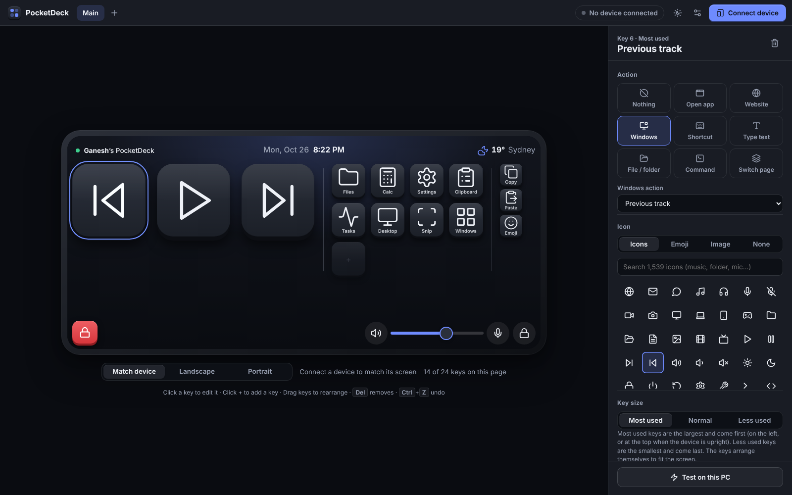
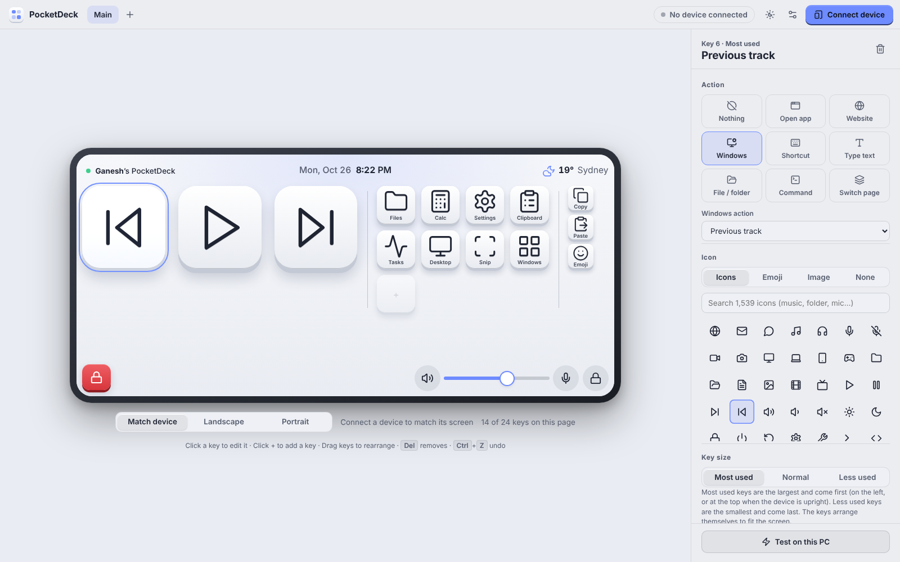
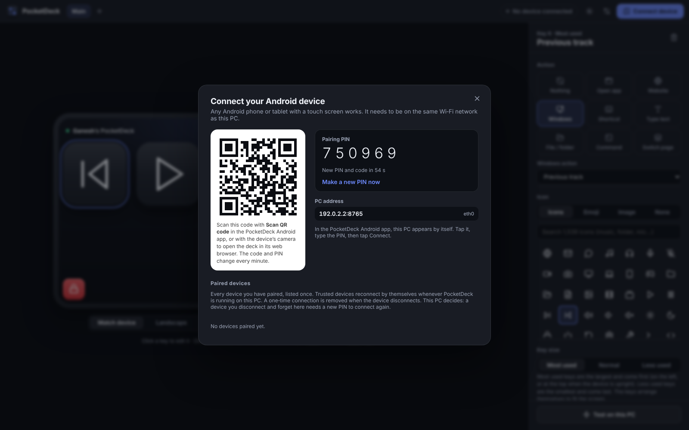
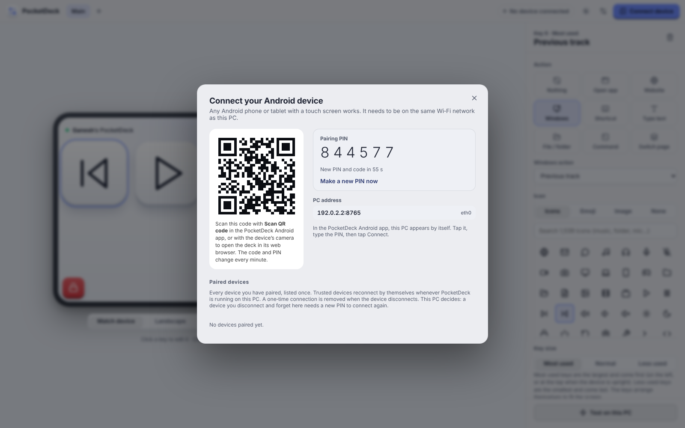
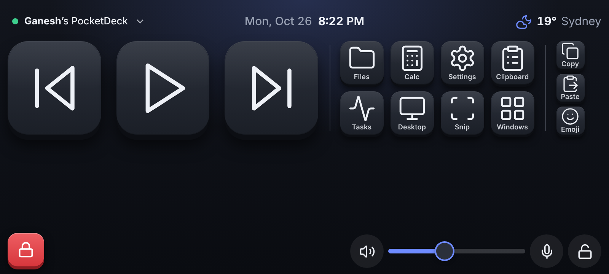
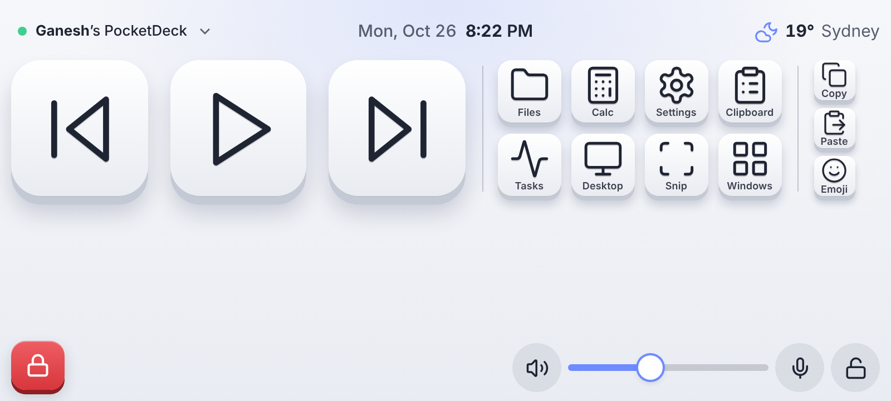

# PocketDeck

Turn any Android phone or tablet with a touch screen into a control deck for your Windows PC.

Created by **Ganesh Acharya**. PocketDeck is a free and open app. If you're happy with it, you can [buy me a plate of momo](https://buymemomo.com/gacharya) 🥟. Feedback, good or bad, is welcome through [gacharya.com/contact](https://gacharya.com/contact?topic=something-else).

- **PocketDeck for Windows** runs in the tray, hosts the deck editor and carries out the actions. The editor's preview takes the size and shape of your connected device, upright or sideways, so you see the deck exactly as it will look.
- **PocketDeck for Android** is a full-screen, always-awake companion for your Android device that connects over Wi-Fi.

## Screenshots

**PocketDeck for Windows: the deck editor.** Pick a key in the preview to change its action, icon, caption, colour and size. The preview matches the size and shape of your connected phone or tablet and turns when it turns.

| Dark theme | Light theme |
| --- | --- |
|  |  |

**Connect device.** Scan the QR code or type the 6‑digit PIN on your Android device. Paired devices are listed under the code.

| Dark theme | Light theme |
| --- | --- |
|  |  |

**PocketDeck for Android: the deck.** Your name, the date and time and the weather along the top; the keys in the middle; the Lock key, page dots, sound controls and rotation lock along the bottom.

| Dark theme | Light theme |
| --- | --- |
|  |  |

Each page holds up to 24 keys, and they arrange themselves to be as big as the screen of any Android phone or tablet allows. Turn the device any way you like; the rotation lock keeps the current direction.

A bar along the top shows your name on the left, the date and time in the centre, and the weather (icon, temperature and place) on the right. A bar along the bottom always holds the red **Lock** key on the left, the page dots in the centre, and on the right: mute, a volume slider (slide your finger along it to change the PC's volume), microphone mute and the rotation lock. Changing the volume or mute shows the usual Windows volume pop-up on the PC, and the microphone button shows a matching pop-up. These bars never move, so the middle of the screen is all keys.

## What the keys can do

| Action | Examples |
| --- | --- |
| Open app | Pick any app from your Start menu, or any `.exe`, shortcut (`.lnk`) or `.bat`, with optional arguments |
| Website | Opens in your default browser; can use the site's own icon |
| Windows action | Volume up/down/mute, play/pause, next/previous, show desktop, task view, switch window, minimize/maximize/close window, File Explorer, Settings, Task Manager, Calculator, Snip, full screenshot, clipboard history, emoji panel, copy/paste/cut/undo/redo/select all, lock, sleep, sign out, restart, shut down |
| Shortcut | Any key combo, recorded or typed (`Ctrl+Shift+M`, `Win+Shift+S`) |
| Type text | Types a snippet into the active window |
| File / folder | Opens a document or folder |
| Command | Runs a hidden command line (`ipconfig /flushdns`) |
| Switch page | Next, previous or a named page (you can also swipe on the deck) |

Each key has an icon (1,500+ built-in icons, emoji, your own image, or the app's or site's icon), an optional caption (top, bottom, left, right or centre), an optional key colour and a size: **Most used** (about twice a normal key), **Normal** or **Less used** (about half). Keys of each size form a group. In landscape the groups stand side by side with the most used on the left; upright, they are stacked with the most used at the top. Thin lines separate the groups, and keys fill each row from the left. Icons cover most of the key and app icons stay sharp even on the biggest keys. Power actions (sleep, sign out, restart, shut down) ask for a second tap on the device. The red **Lock** key in the bottom bar is part of every deck and can't be changed or removed.

Themes: **Obsidian** and **Graphite** (dark), **Porcelain** and **Linen** (light), plus an accent colour. The theme applies to the deck and the editor. You can also put a photo behind the keys: move and zoom it, and choose how much of the theme colour covers it. Icons can show in their own colours or in greyscale. The clock can be digital or analogue, and key presses can give a short vibration, a click sound, both or nothing.

Swipe left or right to change page; the page follows your finger. Tap anywhere on the deck to see how long you've been connected: the time appears at the top right for 10 seconds and the weather moves aside for it.

Your name and photo can appear at the top of the deck, for example **Ganesh**'s PocketDeck. Set them, or hide them, in Settings on the PC.

## Getting the apps

### Build both in the cloud with GitHub (no tools needed)

The *Build PocketDeck* workflow runs on every change (or press **Run workflow** in the **Actions** tab). When both apps build, it tags the code with the version (for example `v1.0.0-b2410262142`) and publishes a release with both files.

1. Open **Releases** on this repository's main page and pick the newest one.
2. Download the two files:
   - `PocketDeck-<version>-Windows-Setup.exe`: run it on your PC. It installs just for your Windows account, so it doesn't need administrator rights.
   - `PocketDeck-<version>-Android.apk`: open it on your Android device (allow *Install unknown apps* when Android asks).

The same files are also attached to each run in the **Actions** tab (*PocketDeck-Windows* and *PocketDeck-Android*).

### Or build on your PC

**Windows app** (needs Node.js 24 or later):

```
npm install
npm start          # run it
npm run dist       # build the installer into dist/
```

**Android app** (needs Android Studio): open the `android` folder, let it sync, then *Build → Build APK(s)*. The build copies the `companion` folder into the app automatically.

### No Android build yet? Use the device's browser

The PC also serves the deck as a web page. In PocketDeck on your PC choose **Connect device** and scan the QR code with your device's camera. It opens the deck in the browser and pairs straight away. The Android app is nicer: true full screen, rotation lock, the screen stays on and it finds your PC automatically.

## Connecting

1. Start PocketDeck on the PC. The first time, Windows Firewall asks about network access: **allow it on Private networks**.
2. Make sure the Android device is on the same Wi-Fi.
3. On the PC, choose **Connect device**. Pairing is only possible while this window is open.
4. In the Android app your PC appears under *PCs on your Wi-Fi*. Tap it and type the 6-digit PIN shown on the PC, or tap **Scan QR code** and point the camera at the code. Then tap **Connect**.
5. Choose **Save for future use** or **Use just this once**.

The PIN and QR code change every minute, after each successful pairing, and whenever the PC removes a device.

### Trusted devices and PCs

- After connecting, the Android app asks whether to **save this PC for future use**. A saved PC is trusted on both sides and listed under *Your PCs*: tap it to connect any time PocketDeck is running on the PC, with no PIN and nothing to do on the PC. A one-time connection is removed from the PC when the device disconnects.
- On the PC, **Connect device → Paired devices** lists every device you have paired, each once. Each has a **Trusted** switch. A trusted device reconnects by itself; a device that isn't trusted needs the PIN again after it disconnects.
- In the Android app, tap your name at the top left to switch between saved PCs, **Connect another PC**, **Disconnect**, or **Disconnect and forget this PC** (the PC forgets the device too). **Disconnect and forget** on the PC does the same from that side; the PC always has the final say.

## Using the editor

- Click **+** in the preview to add a key; the trash button removes the selected one. The count under the preview shows how many of the 24 keys a page uses.
- Click a key to edit it; drag keys to rearrange; `Del` clears a key; `Ctrl+Z` / `Ctrl+Y` undo and redo; arrow keys move between keys.
- **+** next to the page tabs adds a page; double-click a tab to rename it.
- Under the preview, **Match device** (the default) draws the deck at the size and shape of your connected Android device and follows it when it turns, so the preview shows the keys exactly as the device does. **Landscape** and **Portrait** show a typical phone.
- Click the date and time or the weather in the preview (or the settings button) for your name and photo, theme, accent, icon colours, 12/24-hour time, seconds, date, weather location and °C/°F, key press feedback, *Start with Windows*, privacy and About.
- **Test on this PC** runs the selected key's action without the device.
- Changes reach the device instantly. Closing the window keeps PocketDeck running in the tray; quit from the tray icon.

## Privacy

PocketDeck doesn't collect, sell or send your personal data anywhere. There are no accounts, no analytics and no tracking.

- Your deck, your name and your photo are stored only on your PC (`%APPDATA%\PocketDeck`) and sent only to your own paired Android device over your Wi-Fi.
- The Android app keeps its pairing and layout only on the device, and app backups are turned off.
- The only record kept is a small activity log on your PC (`%APPDATA%\PocketDeck\logs`) listing which actions worked or failed, to help fix problems. It never includes typed text, commands, PINs, IP addresses or locations, and it never leaves your PC unless you choose to share it. You can view or clear it in Settings → Privacy.
- Optional features that use the internet, only when you use them:
  - **Check for updates:** sends only which app you use and its version number.
  - **Star rating:** sends only the number of stars, once, when you choose a rating.
  - **Error reports:** sent only when you choose *Send report*. A report contains the error, the app version and the recent list of actions that worked or failed; never your name, photo, typed text, commands or location.
  - **Camera (Android):** used only while you scan the PocketDeck QR code; the picture never leaves the device.
  - **Weather:** the city you pick (not your exact location) is sent to a free weather service to get the temperature. Leave the city unset or switch weather off to send nothing.
  - **Site icons:** "Use the site's icon" downloads the icon directly from that website.
  - **Links:** the momo and feedback links open in your browser only when you tap them.

## Security and "unknown app" warnings

See [SECURITY.md](SECURITY.md) for how PocketDeck is protected.

Windows and Android warn about apps that come from outside their official stores or haven't built a reputation yet. These warnings don't mean anything is wrong:

- **Windows** shows "Windows protected your PC" for new or unsigned installers. Choose *More info → Run anyway*. Publishing through the official Windows store removes this, because the store signs the app.
- **Android** may say the app is from an unknown source or developer. Installing from the official Android store removes this. Builds signed with PocketDeck's own release key (see below) are also treated better than test-signed ones.

### Android release key (one-time setup)

The cloud build signs the APK with your own key when these four repository secrets exist (*Settings → Secrets and variables → Actions*): `PD_KEYSTORE_BASE64` (the keystore file, base64-encoded), `PD_KEYSTORE_PASSWORD`, `PD_KEY_ALIAS` and `PD_KEY_PASSWORD`. Keep the keystore and passwords safe: every future update must be signed with the same key.

## Contributors

- **[Ganesh Acharya](https://github.com/theganeshlife)**: creator and owner; idea, design direction, testing and maintenance
- **[Claude](https://www.anthropic.com/claude)** (Anthropic): co-developer; wrote much of the code, scripts and documentation using Claude Code

## Licence

PocketDeck is released under the [MIT Licence](LICENSE).

## Third-party code

PocketDeck includes the Lucide icons (ISC licence) and jsQR (Apache License 2.0). See [THIRD_PARTY_NOTICES.md](THIRD_PARTY_NOTICES.md).

## Version numbers

PocketDeck has a version number (starting at 1.0.0) and a build number: the date and time the build's code was saved, in Australian Eastern time (AEST/AEDT), as DDMMYYHHMM. The apps show both, e.g. *Version 1.0.0 (October, 2026) Build 2410262140* for a build made at 9:40 pm on 24 October 2026. The cloud build adds the build number by itself. See [CHANGELOG.md](CHANGELOG.md) for what changed.

## Project layout

```
main.js, preload.js      Desktop shell (window, tray, file pickers, app icons)
src/server.js            Local server: editor API, pairing, live deck sync, Wi-Fi discovery
src/actions.js           Windows actions (keys, text, apps, system actions)
src/installed-apps.js    Start-menu app list for the "Choose an installed app" picker
src/activity-log.js      Local activity log
src/store.js             deck.json and devices.json in %APPDATA%\PocketDeck
src/weather.js           Weather, city search, site icons
editor/                  Desktop editor UI
companion/               Deck UI (served to browsers and bundled into the Android app)
android/                 Android app (full-screen deck, Wi-Fi discovery, rotation)
.github/workflows/       Cloud builds for the Windows installer and Android APK
```

`npm run server` starts the server without the desktop window and prints the editor address (actions only run on Windows; elsewhere they are logged).

## Troubleshooting

- **The device can't find or reach the PC**: check both are on the same network and that the network is set to *Private* on Windows. Guest Wi-Fi networks often block devices from seeing each other. You can type the address shown under **Connect device** manually.
- **"Open PocketDeck and choose Connect device"**: pairing only works while that window is open on the PC.
- **Port in use**: PocketDeck uses port 8765 (and the next free one if it's taken), plus UDP 47800 for discovery.
- **A shortcut does nothing in one app**: apps running as administrator ignore input from normal apps. Run PocketDeck as administrator if you need to control them.
- **Sleep hibernates instead**: that's a Windows setting; turn hibernation off with `powercfg /h off` in an admin terminal if you prefer sleep.
